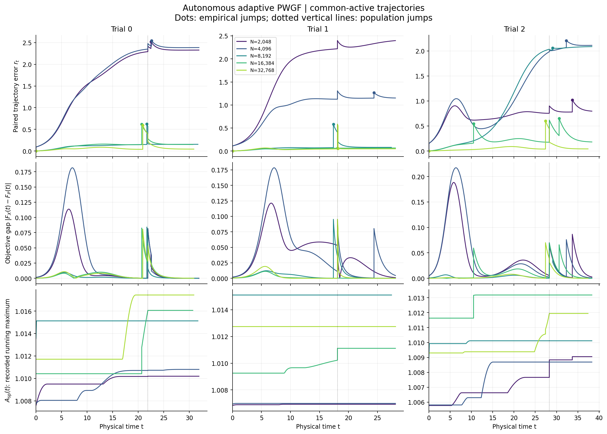
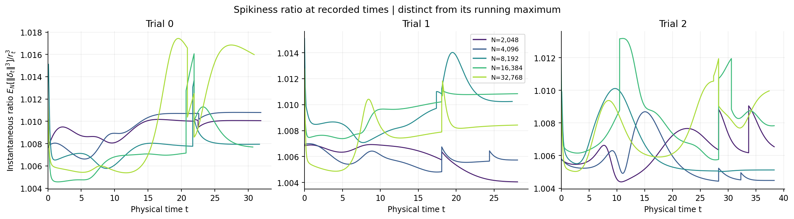
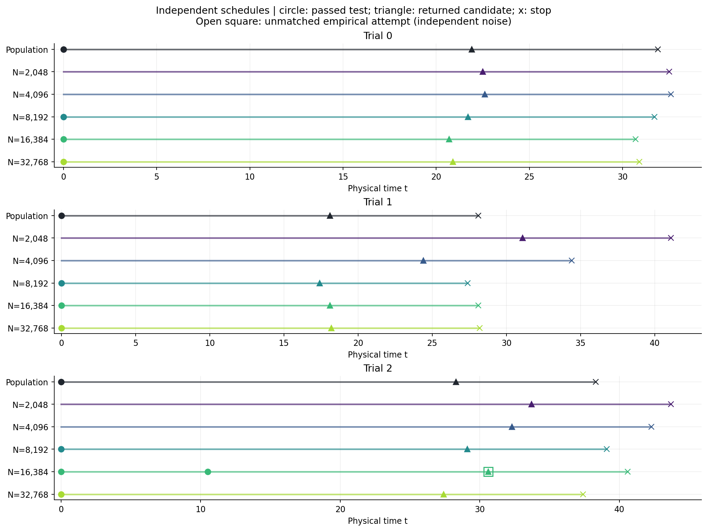
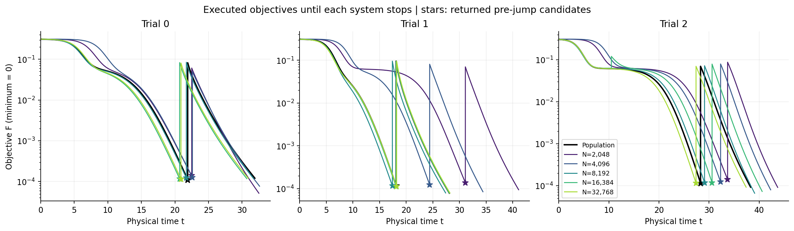
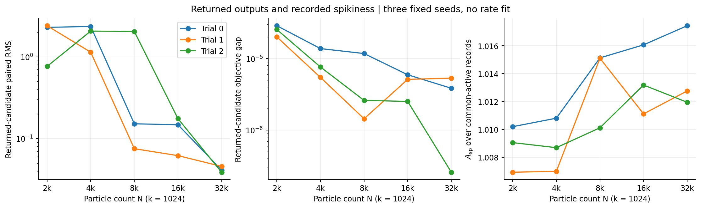

# Adaptive matrix-factorization sanity check

## Setup

Each particle W is a 32-by-2 matrix. A = E[tanh(W)] and F = ||A A^T - M_*||_F^2 / 4. The target has nonzero eigenvalues 1 and 1/2, and the minimum objective is zero. The population has K=32768 equally weighted antithetic atoms. Empirical initial labels are sampled with replacement. K is fixed across N; N=K does not assign one particle to each atom.

Particle counts: [2048, 4096, 8192, 16384, 32768]. Each system uses only its own gradient and objective for control. Gradient RMS <= 0.01 triggers a jump of amplitude 0.2. After 10.0 units of flow time, a decrease <= 0.001 causes the saved pre-jump candidate to be returned. Checks begin at t=0 with interval 0.1; RK4 step 0.05; observation cap 100.0. A passed decrease test resumes inspection on the next tick.

Attempts are coupled by index using the saved population pre-state. Physical jump times can differ. Unmatched empirical attempts use independent noise. The final attempt whose decrease test fails is included.

## Measurements

For the same initial labels, delta_i(t)=X_i(t)-Y_i(t) and r_t=sqrt(mean(||delta_i(t)||_F^2)). The instantaneous spikiness ratio is s_t=mean(||delta_i(t)||_F^3)/r_t^3. A_sp(t) is its recorded running maximum. Ratios with numerically negligible denominators are omitted. Pairwise curves end when either system stops. Returned candidates may have different times; executed paths are not rewound to their candidates.

## Results

The empirical systems stopped in 15/15 conditions.
The largest recorded A_sp is 1.01743828; this is not a continuous-time or high-probability bound.
At N=32768, recorded peak r_t ranges from 0.584 to 0.601. At the end of the common-active interval it ranges from 0.043 to 0.048; returned-candidate RMS ranges from 0.039 to 0.046.
Returned RMS above 1: trial 0, N=2048 (2.296); trial 0, N=4096 (2.356); trial 1, N=2048 (2.405); trial 1, N=4096 (1.141); trial 2, N=4096 (2.069); trial 2, N=8192 (2.043). All conditions are retained.
For these 6 conditions, the largest reconstruction-matrix gap is 0.01444, and the largest mean-factor gap after orthogonal alignment is 0.01454. The plotted particle distances have no alignment applied.
Returned F ranges from 0.000112 to 0.000141. These are candidates returned under the specified thresholds, not limits of indefinite flow.
In 6/15 conditions the initial empirical gradient exceeds the threshold and no jump occurs at t=0. All population trials jump at t=0.
There are 1 unmatched empirical attempts: trial 2, N=16384 (1).

|trial|N|jump times|stop|returned r|returned F gap|returned F|recorded A_sp|
|---|---|---|---|---|---|---|---|
|0|2048|22.50|32.50|2.29615|2.8736e-05|0.000139858|1.010196|
|0|4096|22.60|32.60|2.3561|1.37764e-05|0.000124898|1.010804|
|0|8192|0.00, 21.70|31.70|0.151684|1.17537e-05|0.000122875|1.015131|
|0|16384|0.00, 20.70|30.70|0.147637|5.93639e-06|0.000117058|1.016067|
|0|32768|0.00, 20.90|30.90|0.041251|3.84744e-06|0.000114969|1.017438|
|1|2048|31.10|41.10|2.40461|2.00452e-05|0.000137552|1.006928|
|1|4096|24.40|34.40|1.14118|5.45589e-06|0.000122962|1.006992|
|1|8192|0.00, 17.40|27.40|0.0752012|1.44332e-06|0.000116063|1.015104|
|1|16384|0.00, 18.10|28.10|0.0618542|5.12041e-06|0.000112386|1.011114|
|1|32768|0.00, 18.20|28.20|0.0456885|5.32492e-06|0.000112182|1.012758|
|2|2048|33.70|43.70|0.764154|2.54343e-05|0.000140886|1.009052|
|2|4096|32.30|42.30|2.06859|7.62212e-06|0.000123074|1.008689|
|2|8192|0.00, 29.10|39.10|2.04273|2.6051e-06|0.000118057|1.010115|
|2|16384|0.00, 10.50, 30.60|40.60|0.175458|2.52e-06|0.000117972|1.013183|
|2|32768|0.00, 27.40|37.40|0.0387495|2.5863e-07|0.000115193|1.011946|

## Numerical checks

All nine archived job audits passed. Integration-refinement gate: True.
Halving the RK4 step changes jump times by at most 0, and matched-record r_t by a relative amount at most 2.53e-08.
Halving the inspection interval changes jump times by at most 0.05, and returned states by an RMS amount at most 0.00049473.
Attempt counts agree under inspection refinement: True. The largest returned F change is 4.89532e-06.
Small returned-objective gaps should be interpreted with this grid sensitivity in mind. Asynchronous-jump mismatches are distinct from ODE integration errors.

## Limitations

Three trials and a fixed atomic population provide descriptive evidence. They establish neither a convergence rate, adaptive superiority, nor an all-time non-spikiness bound. Attempt-index adaptive coupling is outside the prescribed common-schedule theorem. A same-time supremum discrepancy can retain a jump-sized peak even as the jump-time lag shrinks. Spikiness concerns paired errors, not the spread of particle positions.

## Provenance

Each PDF/PNG filename records its generation time in JST and the first 12 hexadecimal digits of its own SHA-256. The figure manifest records full hashes and input provenance. See the package README for the distinction between archived scalar records, optional state snapshots, and a full rerun.

